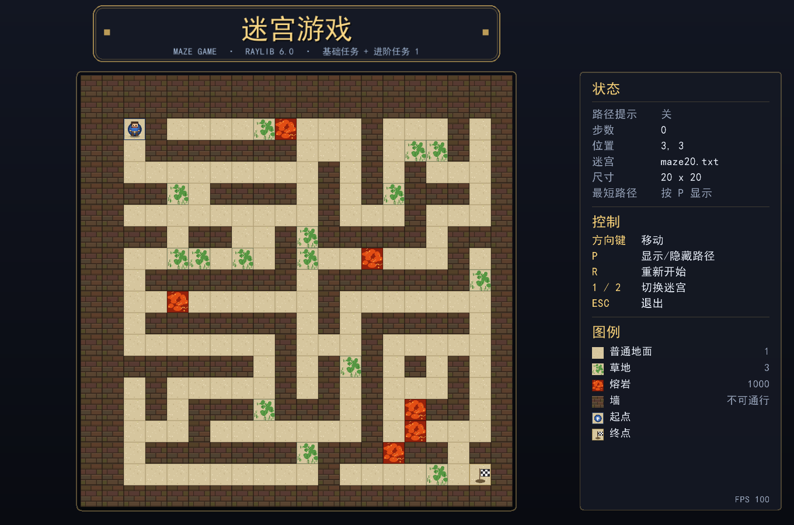
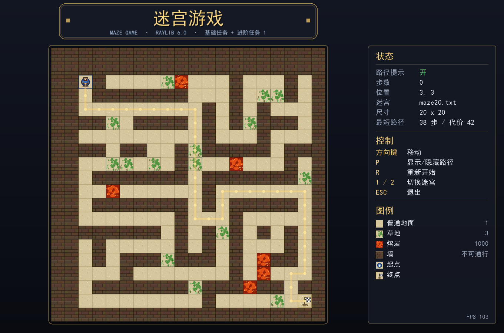
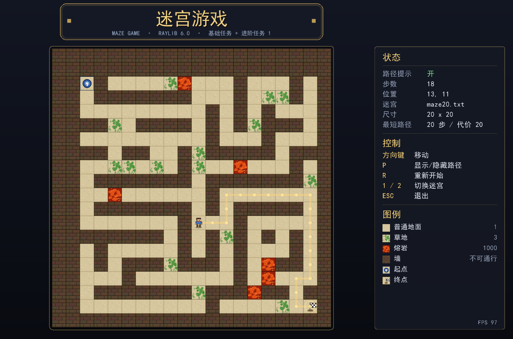
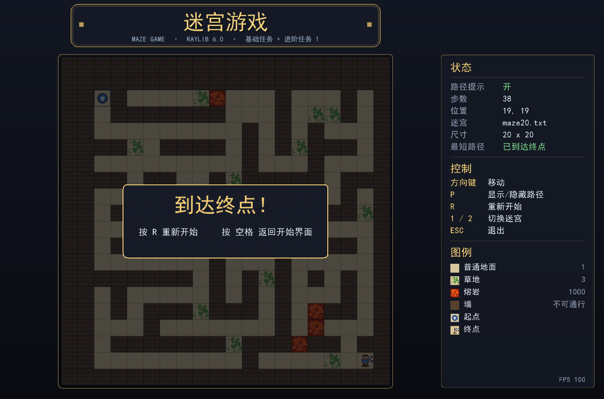
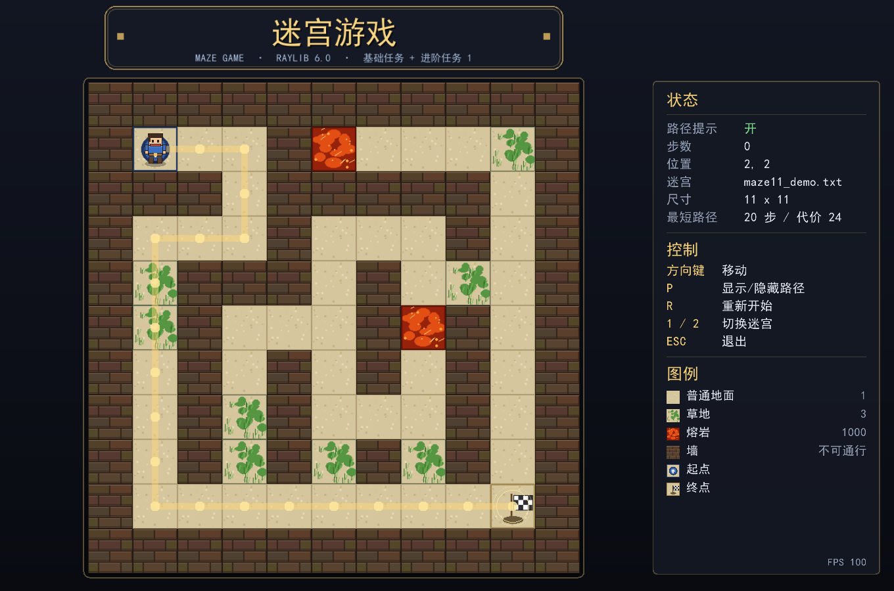

# 迷宫游戏（Raylib 6.0 · 基础任务 + 进阶任务 1）

《程序设计综合实践》迷宫游戏：用 Raylib 6.0 绘制图形化迷宫，方向键控制小人行走，
`P` 键显示从当前位置到终点的带权最短路径；含开始界面（空格开始）与到达终点的胜利提示。


## 1. 已完成的基础任务

| 说明书要求 | 实现情况 | 代码位置 |
| --- | --- | --- |
| 1. 创建窗口并显示读取的图片文件 | 创建 1360×900 窗口；读取 `assets/ui/title.png` 作为标题横幅、`assets/ui/icon.png` 作为窗口图标、7 张地块贴图 | `src/main.cpp`、`src/render/Renderer.cpp` |
| 2. 根据迷宫源文件用图片资源显示图形化迷宫 | 解析 txt 迷宫，按地块类型绘制对应贴图，并动态适配窗口尺寸 | `src/core/Maze.cpp`、`src/render/Renderer.cpp` |
| 3. 小人在迷宫中用方向键行走，不能穿墙，起点开局 | 网格移动 + 短动画；目标格为墙或越界时拒绝移动；初始位置取迷宫起点 `-1` | `src/core/Player.cpp`、`src/game/GameApp.cpp` |
| 4. 路径提示开关，显示到终点的最短路径 | `P` 键开关；用 Dijkstra 计算带权最短路并画成金色虚线；面板显示步数与代价 | `src/core/PathFinder.cpp`、`src/render/Renderer.cpp` |
| 5. 自设计 20×20 迷宫并测试 | `mazes/maze20.txt`（起点 (2,2)、终点 (18,18)，0 起算）；最短路径 38 步 / 代价 42 | `tools/gen_maze.py`、`mazes/maze20.txt` |

另外附带一个 11×11 演示迷宫 `mazes/maze11_demo.txt`，可用 `1` / `2` 键切换。

## 2. 已完成的进阶任务 1：完整游戏流程

| 说明书要求 | 实现情况 | 代码位置 |
| --- | --- | --- |
| (a) 开始界面，提示按下空格键开始游戏 | 独立的开始画面：标题、呼吸闪烁的“按 空格 键 开始游戏”、操作说明与地块图鉴；按空格（或回车）进入游戏 | `src/render/Renderer.cpp` `drawTitleScreen()`、`src/game/GameApp.cpp` |
| (b) 游戏开始时，小人处于“起点”地块 | 开始游戏 / 重开时调用 `Player::reset(maze.start())`，位置取自迷宫文件里的 `-1` | `src/game/GameApp.cpp` `startGame()` / `resetPlayer()` |
| (c) 小人处于“终点”地块时提示游戏胜利 | 走到终点弹出“到达终点！”遮罩，可按 `R` 重新开始、按空格返回开始界面 | `src/render/Renderer.cpp` `drawWinOverlay()` |

除了进阶任务 1，进阶任务 2（草地减速、熔岩失败）、3（怪物、随机迷宫）、4（其他趣味功能）尚未实现。

## 3. 运行环境

- Windows 10/11 x64，MinGW-w64 `g++ 14.2.0`（`C:\mingw64`）
- CMake ≥ 3.25、Ninja
- Raylib **6.0**：源码已随工程放在 `third_party/raylib-6.0`，编译时由本机 MinGW 一起构建

> 工程路径包含中文，**必须使用 Ninja 生成器**。MinGW Makefiles（`mingw32-make`）无法处理中文绝对路径，
> 这也是 `run.bat` 固定使用 Ninja 的原因。

## 4. 编译与运行

最简单的方式是双击（或在终端执行）`run.bat`，它会自动完成配置、编译和运行：

```bat
run.bat
```

也可以手动执行：

```bat
cmake -S . -B build -G Ninja
cmake --build build
build\maze_game.exe
```

编译产物 `build/maze_game.exe` 旁边会自动复制 `assets/` 与 `mazes/`，所以直接在 `build` 目录运行也能找到资源。

## 5. 操作说明

| 按键 | 功能 |
| --- | --- |
| 空格 / 回车 | 开始界面进入游戏；到达终点后返回开始界面 |
| ↑ ↓ ← → / W A S D | 移动小人（按住可连续行走） |
| P | 显示 / 隐藏最短路径提示 |
| R | 重新开始（小人回到起点） |
| 1 / 2 | 切换 20×20 迷宫 / 11×11 演示迷宫 |
| ESC | 退出游戏 |

路径提示打开时，金色虚线从“小人当前格”连到终点，右侧面板同时显示最短路径的步数与行走代价。
小人走到终点会显示“到达终点！”提示。

## 6. 界面截图


| 路径提示关闭 | 路径提示打开（38 步 / 代价 42） |
| --- | --- |
|  |  |

| 走了 18 步后（剩余 20 步 / 代价 20） | 到达终点 |
| --- | --- |
|  |  |

| 11×11 演示迷宫（20 步 / 代价 24） |
| --- |
|  |

## 7. 目录结构

```
迷宫游戏/
├─ CMakeLists.txt          # 构建配置（同时编译 raylib 6.0）
├─ run.bat                 # 一键配置 + 编译 + 运行
├─ assets/
│  ├─ tiles/               # 地面、墙、草地、熔岩、起点、终点、小人贴图（64×64 PNG）
│  ├─ ui/                  # 标题横幅、窗口图标
│  └─ fonts/simhei.ttf     # 界面中文字体
├─ mazes/
│  ├─ maze20.txt           # 自设计 20×20 迷宫（任务 5）
│  └─ maze11_demo.txt      # 11×11 演示迷宫
├─ src/
│  ├─ main.cpp             # 入口：解析参数、创建窗口、设置图标
│  ├─ core/                # 与绘制无关的核心逻辑（可独立单测）
│  │  ├─ Maze.h/.cpp       #   迷宫数据读取与校验
│  │  ├─ PathFinder.h/.cpp #   Dijkstra 带权最短路径
│  │  └─ Player.h/.cpp     #   小人位置、行走规则、换位动画
│  ├─ game/GameApp.h/.cpp  # 主循环、键盘输入、画面状态（开始界面 / 游戏中）
│  ├─ render/              # 渲染层
│  │  ├─ Renderer.*        #   开始界面/迷宫/路径/小人/状态面板绘制
│  │  ├─ TextRenderer.*    #   中文文字绘制（按需载入字形）
│  │  └─ AssetPaths.*      #   资源路径解析
│  └─ tests/core_tests.cpp # 核心逻辑单元测试
├─ tools/                  # 资源生成与验证脚本（Python，非必需）
│  ├─ gen_assets.py        #   生成地块与界面图片
│  ├─ gen_maze.py          #   生成并校验迷宫文件
│  ├─ render_preview.py    #   把迷宫源文件渲染成 PNG 预览
│  └─ solve_maze.py        #   求迷宫解法并输出方向序列
├─ docs/screenshots/       # 运行截图
└─ third_party/raylib-6.0/ # Raylib 6.0 源码（MIT 许可）
```

## 8. 迷宫源文件格式

与任务说明书第 4 节一致：第一行是 `行数 列数`，之后每行是各列地块类型，用空格分隔。

| 数字 | 含义 | 行走成本 |
| --- | --- | --- |
| -2 | 迷宫终点 | 1 |
| -1 | 迷宫起点 | 1 |
| 0 | 普通地面 | 1 |
| 1 | 墙 | 不可通行 |
| 2 | 草地 | 3 |
| 3 | 熔岩 | 1000 |

读取时会校验：首行尺寸、数据个数、地块取值、起点/终点各恰好一个、行列数是否匹配。
`mazes/maze20.txt` 的第一行是 `20 20`。

## 9. 最短路径算法

`PathFinder::shortestPath` 使用 Dijkstra 算法（优先队列）：

- 节点为全部非墙地块，边为上下左右相邻；
- 进入相邻格的成本由 `Maze::enterCost` 给出：普通/起点/终点 1、草地 3、熔岩 1000；
- 用 `dist[]` 记录最小代价、`prev[]` 记录前驱，终点出队后回溯得到完整路径；
- 返回路径总代价和逐格路径（`PathResult`）。

因为草地上“绕路”可能比“直穿”更便宜，所以 20×20 迷宫中刻意在最短路径上放了两块草地，
界面显示 38 步 / 代价 42（38 步普通成本 38，其中 2 步踩草地，每步多 2）。

## 10. 测试与验证

### 10.1 核心逻辑单元测试（193 项检查）

```bat
build\core_tests.exe
```

覆盖：迷宫解析与各类非法数据、草地/熔岩成本、Dijkstra 绕开熔岩、路径连续性与可通行性、
自设计 20×20 与 11×11 迷宫的最短路径结果（38 步/42 代价、20 步/24 代价）、
小人撞墙/动画期间拒绝移动/重开等。

### 10.2 界面自动化截图与流程验证

```bat
build\maze_game.exe --shot=shot.png --frames=40
build\maze_game.exe --skip-title --path-on --shot=shot.png --frames=40
```

- `--shot` 渲染若干帧后保存截图并退出，用于检查界面；
- `--skip-title` 跳过开始界面直接进入游戏（截图/调试用）；
- `--walk=UDLR...` 启动时按方向序列自动走若干步，例如 `--walk=DDRRRRRRRRDDDDDDDD` 后截图即为“走了 18 步”的状态；
- 开始界面的空格键通过向窗口发送 `WM_KEYDOWN/WM_KEYUP` 验证，确认能正常进入游戏。

`docs/screenshots/` 中的 6 张截图均由这种方式生成。

## 11. 说明与后续

- 已完成基础任务 1–5 与进阶任务 1（开始界面、起点开局、胜利提示）；
- 进阶任务 2/3/4（草地减速、熔岩失败、怪物寻路、随机迷宫、其他趣味功能）尚未实现，
  可按 `Player`、`GameApp`、`Renderer` 现有结构继续扩展；
- 图片资源由 `tools/gen_assets.py` 用 Pillow 生成；`simhei.ttf` 取自本机 Windows 字体，
  仅用于本机展示中文界面；`tools/` 脚本不是编译运行所必需的；
- Raylib 6.0 以源码形式附带，遵循其 MIT 许可证。
